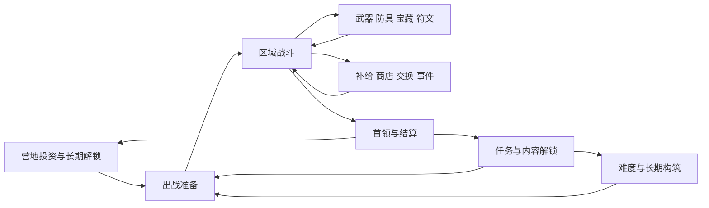
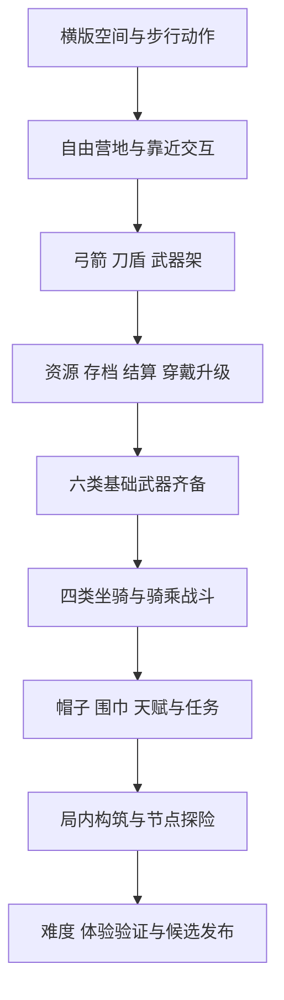

# 波次远征 · 系统学习与开发计划 V3

日期：2026-10-27  
创建人：ScarfQian  
当前项目：pelican-knight-waves · 0.4.0  
修改编号：`20261027-009`

## 当前决定

用户批准保留原版并另建项目：沿用 v0.3.2 全部美术，回到俯视角，以 30 波替代生存计时。六种基础武器、帽巾、四类坐骑与自由营地保留。卡片、精粹、装备等级归属于本次远征；通关携带配置，失败或主动结束清零。

本节 V3 是新项目当前方案。下方 V2 保留此前参考游戏系统研究、来源和历史设计；涉及横版、永久天赋/强化、海贝奖励、180 秒条件的实施结论已被 V3 替代。参考系统供后续选用，不自动扩大本次开发范围。本轮未新增外部游戏资料调查。

| 系统 | 0.4.0 的实现与边界 |
| --- | --- |
| 视角与战斗 | x/d 等比例八方向移动，双轴相机，自动瞄准普攻；保留六武器特色和坐骑操作 |
| 波次 | 默认 30 波，有限生成，清场推进；每波普通数量 5+floor(波次×1.1) |
| 精英 / 首领 | 5/10/15/20/25/30 波各一精英；30 波另有首领，全部清理才算通关 |
| 增强卡 | 普通波 1 倍；精英品质六级递增为 2—7 倍，选项显示上限内实际增益 |
| 经济 | 杀敌精粹，清场自动回收；10/20/30 波选卡后装备强化，四槽最高 +5 |
| 成长期限 | 本次远征内，失败/结束/重开清零；无永久属性成长 |
| 地图续接 | 第一地图已实现；通关保存完整配置，第二地图按钮禁用，后续新增怪物与强度待设计 |
| 美术 | 复用全部固定 ID 与 SVG，实例位置、朝向和动作不改变资产源 |
| 存档 | 独立键，只保存基础配置、纪录和已通关远征；无战斗中续局 |

## 工作排期

以下为依赖顺序与预估工作量，不是自动执行日程。开发实录统一放 DEVELOPMENT.md，发布状态统一放 version.json。

| 顺序 | 工作 | 当前状态 | 开始条件 / 预计投入 |
| --- | --- | --- | --- |
| W1 | 原 PR 合并、复制项目、建立独立仓库 | 已完成，仓库与目录独立 | 用户已授权 |
| W2 | 俯视移动、自动战斗、30 波/精英/首领 | 0.4.0 已写入 | 本轮实现 |
| W3 | 精英卡、精粹商店、结束清零、通关保留 | 0.4.0 已写入 | 本轮实现 |
| W4 | 静态检查、快照、日志、首版发布 | 已完成，Pages 已发布 0.4.0 | 不运行游戏或游戏测试 |
| W5 | 玩法验收与数值调整 | 待用户授权试玩 | 1—2 次开发会话；覆盖 5/10/20/30 波、技能、购买、清零与存档 |
| W6 | 第二地图与新怪物 | 待需求 | 先确定场景、敌人组合与递进强度，再补地图登记/续接/结算；预计 2—3 次会话 |
| W7 | 武器/卡片协同、节点事件与商店扩展 | 待选择 | 按下方参考研究挑选一个系统逐步实现，避免一次引入全部 |

## 后续学习重点

继续参考既有研究中“武器差异—局内构筑—收益消费—地图推进”的关系，优先验证当前六种武器与四坐骑是否都有可用的构筑路径。原作美术、程序和资源不复制；只学习系统关系。先确认第一地图的战斗节奏与精粹收支，再设计第二地图的新敌人与递进强度，最后决定是否引入节点地图、商人、事件和高级装备。

---

## 继承资料：原版计划 V2（历史方案，以下保留原文）

# 《失落城堡2》系统学习与《鹈鹕骑士》复刻计划

日期：2026-10-27  
创建人：ScarfQian  
计划版本：V2  
修改编号：`20261027-008`  
项目登记版本：0.3.2，横版基础系统、统一资产库与造型修订  
状态：五项需求的基础代码已写入，40 张固定资产卡已接入，其中 37 项活跃资产已优化为 r2；行为验收待验证。0.3.2 已推送至 [PR #1](https://github.com/ScarfQian/pelican-knight/pull/1)，待用户决定是否合并 main。未运行游戏或游戏测试。

## 1. 结论与使用方法

**目标调整为原创横版动作肉鸽：鹈鹕默认步行，营地自由移动，自行车和摩托车作为坐骑，六类基础武器决定战斗方式，帽子与围巾可更换和升级。**资源、存档与结算纳入首个成长循环。先建立横版空间、动作与交互，再连接“出发—战斗—结算—营地换装/强化—再次出发”。

V1 中“继续俯视角自动攻击”“营地先不自由移动”“武器/车架/挂饰三槽”“围巾只作后期外观”的建议已被本次用户决定替代。0.2.2 时只修改方案；用户随后要求开始实施，0.3.0 已将当前 HTML 改为横版。原俯视内容保留在旧快照，不能再用它反推新游戏必须维持相同操作方式。

### 1.1 已确认方向与待设计细节

| 编号 | 用户已经确定 | 设计细节（当前采用情况见 1.3） |
| --- | --- | --- |
| U01 | 改为横版，营地可自由移动 | 横版卷轴加有限前后走位，跳跃高度独立；接近建筑交互 |
| U02 | 默认步行；普通自行车加速，山地车可跳起攻击，公路车更快且可冲撞，摩托车兼具两者并定时远射 | 上下车、骑乘用武器、冷却、速度差、解锁条件与受击规则 |
| U03 | 弓箭、刀盾、太刀、巨型双手武器、法杖、散弹枪；先只做各类基础武器；铁匠铺旁专门换武器 | 六类动作、输入、技能资源、有效距离和收招；初期免费试用全部基础类型 |
| U04 | 帽子和围巾是可更换、可升级的装备 | 每槽先两件、固定效果、升级上限与价格；外观随装备变化 |
| U05 | 加入资源、存档、结算 | 海贝等资源命名、收益、失败/退出政策、迁移与保存时点 |

“摩托车间隔时间发射远程设计”按“定时远程射击”理解。摩托车虽不是自行车，仍与三类自行车统一列入坐骑系统，不省略其能力，也不增加用户未要求的高级武器。

这里的“复刻”指独立实现可观察的玩法机制和系统结构。角色、美术、文案、地图、数值使用本项目的原创设计；本轮没有提取原作素材、程序或资源包。

本文件同时承担系统分析、设计草案、学习大纲和计划排期职责。实际发生的开发记录继续追加到 [DEVELOPMENT.md](DEVELOPMENT.md)，当前实现与接手状态由 [HANDOFF.md](HANDOFF.md) 和 [version.json](../version.json) 指示，不另建第二套进度日志。

阅读路径：理解参考游戏先看第 3—4 节；确定本项目方案看第 5—8 节；安排下一次工作看第 9—11 节；来源与证据限制看第 12 节。

### 1.2 信息身份必须分开

| 类型 | 本文件含义 |
| --- | --- |
| 参考资料事实 | 官方介绍或 Wiki 当前页面的陈述，附来源；不等于已实机核实 |
| 系统设计分析 | 从多项机制之间的关系推导出的设计作用，不冒充开发者原意 |
| 用户已定方向 | U01—U05；后续不再把横版、四坐骑或六武器种类重新列为待选择 |
| 本项目建议 | 原创规则、数量、数值与排期；未采用的部分仍为草案，当前采用情况见 1.3 与各阶段状态 |
| 当前实现 | 已写入 0.3.0 的源码行为；没有运行验证，不等同于玩法验收通过 |

V1 已阅读 Wiki 的主要系统页面与部分任务、敌人实例，覆盖营地、战斗、装备、构筑、地图、经济、任务、长期成长、合作与外观。V2 复用这些来源，重点修订本项目方案，没有新增原作实机结论。没有穷举每件装备、每个房间和每种首领，也没有验证 Wiki 引用的反编译结果。

### 1.3 0.3.0 的实施状态与草案差异

2026-10-27，用户明确要求“开始开发，把刚刚五项全部实现”。本轮写入五项需求对应的基础系统，登记 `20261027-006`。以下是当前源码规则；数值、操作手感与完整流程尚未实测。

| 范围 | 0.3.0 当前采用 | 与初版草案的关系 |
| --- | --- | --- |
| 空间与营地 | 横版左右为主、少量纵深、独立跳跃；默认步行；靠近 E 交互与路标自动行走 | 采用带状场景方案；营地角色可控制 |
| 六基础武器 | 全部免费切换，木桩练习无收益；六类分别实现动作、特色和资源 | 不再只等待 H2 两武器样例，六类一起写入基础原型 |
| 四基础坐骑 | 全部免费选择；速度 1.30/1.35/1.65/1.50；山地/摩托跳击，公路/摩托冲撞，摩托定时远射 | 暂不采用循序解锁，先让能力完整可体验；摩托能力没有删减 |
| 帽子/围巾 | 每槽两件、独立 0—3 级；首套免费，另两件各 16 海贝；强化 12/24/36 | 采用独立成长和可见换装；费用是当前参数，非平衡结论 |
| 天赋 | 守护、武艺、远行各三节点；初始 3 出战点，领奖增加，上限 6；免费重配与前置退点 | 分支名称和效果改为适配当前武器；不重新收费解锁坐骑固有能力 |
| 任务 | 五项自动接取的一次性委托：首航、50 击退、强化、首个天赋、横版胜利 | 第六项探险节点任务等 H7 地图实现后再开放 |
| 资源/存档/结算 | 永久海贝、局内珍珠；新档与旧纪录分开；每完整 30 秒 2 海贝最多 12，获胜 +6 | 采用阶段收益草案；失败结算，主动退出/重开/刷新不结算，无续局 |
| 局内成长/海岸 | 八类通用升级；180 秒且击败首领，135 秒出场，首领 1250 体力 | 原鱼镖升级与敌潮数值重新适配；H6 完整构筑仍未实现 |

完整字段、操作和参数见 [HANDOFF.md](HANDOFF.md) 与 [README.md](../README.md)。本计划第 5—8 节同时保留后续设计，不能将其中所有建议理解为已经存在于游戏。H1—H5 对应基础代码记“实现完成待验证”，H6—H9 未因本轮写入代码而自动完成。

### 1.4 资产建档与后续复用

用户要求为人物、怪物、装备、车、建筑建档，避免每次使用时重做造型。0.3.1 已建立 [40 卡静态图鉴](assets.html)、[PNG 总览](assets-overview.png)与[复用约定](../assets/README.md)，图形基线来自 0.3.0。人物 4、怪物 6、武器 6、穿戴 4、车 4、建筑/设施 7，以及辅助物件 6、历史素材 3，均有固定编号与修订号。

后续 H6—H9 新地图、战斗与装备组合优先复用该目录。图形与挂点维护于 `assets/sprites.svg`，档案及运行定义维护于 `assets/catalog.json`，同步工具嵌入游戏和图鉴；不是每次按文字重新生成。新造型分配新编号，原造型改动递增修订号；普通数值调整不自动换外形。卡片记录现有能力与不足，不等于美术定稿或玩法验收。

0.3.2 按用户明确要求优化全部活跃资产：修复鹈鹕上喙与喉囊连接，完善人物、怪物、六武器、两帽两围巾、四车、七设施和六辅助物件。37 项升为 r2，3 项历史素材保持 r1；增加[嘴部前后对照与六种组合预览](assets-detail.png)。图形源与游戏共用，围巾改为整体图层摆动以保留纹样；不改变伤害、碰撞、价格、存档和玩法规则。该美术修订不改变 H 系列排期或将行为验收标为完成。

## 2. 规划起点与当前实现

0.2.2 的规划起点是俯视自动鱼镖与点击式营地；历史事实保留在 `20261027-005` 及此前日志。以下按 0.3.0 源码更新当前状态。

| 范围 | 当前已写入代码 | 后续能力或验证 |
| --- | --- | --- |
| 游戏入口 | 自由移动海风镇、靠近交互、武器架、停车点与练习木桩 | 实测各入口可达、窗口焦点与触屏操作 |
| 基础战斗 | 横版手动攻击、前后纵深、跳跃、闪避、格挡、弹道高度判定 | 动作衔接、受击反馈、全部武器通关能力 |
| 坐骑 | 步行/骑乘切换与四车完整固有能力 | 骑乘兼容实测；后期解锁和平衡仍需另定 |
| 武器与穿戴 | 六基础武器、两帽两围巾、可见换装和三级强化 | 价格、伤害和手感观察；没有高级武器 |
| 局内成长 | 八类通用候选，珍珠三选一、满级过滤 | H6 的流派标签、约 18 候选、门槛和状态 |
| 敌人与节奏 | 六敌人、横版追击/远射/预警冲锋；重设体力与伤害 | 可配置遭遇、地区生态及实际难度 |
| 地图与目标 | 唯一横版海岸试炼，180 秒且击败首领 | H7 地图路线、节点、商店事件与地图解锁 |
| 营地成长 | 穿戴、九天赋、永久海贝、出战配置 | 保存重开、属性一致性与成长节奏实测 |
| 任务与记录 | 五项自动委托、累计进度、一次领取；公告栏更新 | 探险任务和内容解锁，未进行实际领奖验证 |
| 存档 | 新永久档、独立旧纪录、保存失败提示、重试与导出 | 实际迁入/重开验证；导入、云存档不在本版 |
| 发布 | 0.3.2 已提交推送并创建 PR #1，线上版本 0.1.1 | 是否合并 main 并更新 Pages，由用户决定 |
| 验证 | 编译解析与引用静态核对、独立源码审阅 | 游戏运行、浏览器、移动端、性能均未执行 |

当前 `offerUpgrades()` 从未满级候选中等概率、不重复抽取至多三项；候选不足时按实际数量展示。每局由 `makeGame()` 从永久配置重新建立角色，临时成长不跨局。旧鱼镖参数只作为历史记录，不再套用于六种武器。

当前分支为 `feat/camp-town`，此前累计修改与快照已提交推送到 PR #1，继续保护，不切换或重置分支。代码已上传与功能已通过体验验收必须分开记录。

## 3. 参考游戏的整体系统设计

[官方介绍](https://store.steampowered.com/app/2445690/Lost_Castle_2/?l=schinese)将《失落城堡2》定位为横版 Rogue-Lite 动作冒险，强调武器动作、装备、宝藏、地区与首领，并支持单人和合作。它与当前项目共享“每局成长、失败再来”的基础，但操作负担、关卡组织和单局构筑长度不同。

### 3.1 四个相互嵌套的循环

| 时间尺度 | 循环 | 系统作用：本文件的设计分析 |
| --- | --- | --- |
| 数秒 | 识别预警 → 走位/闪避 → 攻击 → 收招/恢复 | 提供可学习的动作反馈；装备差异首先改变行为 |
| 一个区域 | 遭遇敌人 → 清空/挑战 → 选择奖励 → 前往下一区域 | 让战斗、恢复和决策交替，改变风险与资源余额 |
| 一次冒险 | 初始配置 → 武器与宝藏组合 → 首领检验 → 结算 | 临时构筑形成变化，失败仍可能贡献长期进度 |
| 多次冒险 | 营地投资/解锁 → 新出发条件 → 更高难度 → 新奖励 | 逐步增加可选内容和挑战，形成长期目标 |

关键连接是结算：[武器](https://lc2.huijiwiki.com/wiki/武器)和[结算](https://lc2.huijiwiki.com/wiki/结算)页面说明，局内武器、防具、魂晶、魔铁锭在离开冒险后清空，宝藏可在结算时转为金币；[营地投资](https://lc2.huijiwiki.com/wiki/营地投资)再把金币消耗为长期能力。**原作的局内装备不是默认永久保留的仓库收藏。**

### 3.2 系统关系图

下图概括阅读所得的机制连接，不代表原作代码架构。



### 3.3 最值得学习的五点

1. **成长分层。**营地基础投资、开局配置、局内宝藏、符文组合和后期刻印各有时机与用途。合并成一个无限加攻击的天赋树，会失去选择。
2. **随机中保留方向。**宝藏的流派门槛、关联权重、商店和交换机制，让玩家有机会修正构筑；抽到什么与如何使用它共同决定结果。
3. **敌人承担不同压力。**远程攻击者、增益支援者和首领改变目标优先级与走位，而不只是体力不同。
4. **区域是节奏单位。**战斗、挑战、休息和事件交替，使资源管理有意义；地图不只是背景换色。
5. **后期挑战改变规则。**难度修正与可选难度词条连接到长期解锁，而不是只把敌人体力持续放大。

## 4. 各类系统拆解与适配

以下保留 V1 的参考资料分析，适配方向改按本次用户决定。H1—H9 是第 9 节的新版阶段；E 是首轮 20 周建议范围之外的扩展。V1 的 P1—P8 尚未执行，已由新版任务取代，编号不复用以免日志混淆。

| 系统 | 参考资料事实与来源 | 设计作用与《鹈鹕骑士》适配建议 | 阶段 |
| --- | --- | --- | --- |
| 营地与建筑服务 | [营地投资](https://lc2.huijiwiki.com/wiki/营地投资)：冒险前准备，投资节点分属不同设施，另有任务与招募入口 | 横版自由行走，靠近居民交互；熊猫、仙鹤、秦始皇保留，铁匠旁独立武器架 | H1—H2 |
| 角色操作与武器动作 | [武器](https://lc2.huijiwiki.com/wiki/武器)、[角色](https://lc2.huijiwiki.com/wiki/角色)：武器动作/技能差异、法力消耗、闪避保护 | 默认步行、手动普通攻击与特色动作；各做一把六类基础武器，不扩展高级武器 | H1—H3 |
| 坐骑 | 本项目原创要求，不冒充原作系统 | 普通车加速、山地车跳击、公路车冲撞、摩托车兼具能力并定时远射；冷却与人物武器分开 | H4 |
| 属性与伤害 | [伤害](https://lc2.huijiwiki.com/wiki/伤害)：命中判定、攻击类型、暴击、增减伤和持续碰撞规则共同作用 | 区分武器、坐骑、穿戴、天赋和局内效果；增加横向、纵深、跳跃高度的判定 | H1—H3、H6 |
| 硬直、失衡与元素 | [韧性](https://lc2.huijiwiki.com/wiki/韧性)是单次削韧比较；[失衡](https://lc2.huijiwiki.com/wiki/失衡)是累积阈值；[火属性](https://lc2.huijiwiki.com/wiki/火属性)、[冰属性](https://lc2.huijiwiki.com/wiki/冰属性)有积累与异常效果 | 基础受击硬直先服务六类武器；失衡与元素后加，分别定义持续/累积规则 | H2—H3、H6 |
| 武器与穿戴 | [武器](https://lc2.huijiwiki.com/wiki/武器)、[防具](https://lc2.huijiwiki.com/wiki/防具)：类别、品质、强化和特殊效果 | 武器槽与帽子、围巾槽分开；初期不做随机武器品质/洗练，铁匠提供帽子与围巾升级 | H2—H3、H5 |
| 宝藏与容量 | [宝藏](https://lc2.huijiwiki.com/wiki/宝藏)：被动主效果、副效果、符文要求及重量限制 | 三选一保留为局内成长形式，但候选需适配当前武器与坐骑；有容量的遗物后加 | H6、E |
| 符文与流派门槛 | [阿希尔](https://lc2.huijiwiki.com/wiki/阿希尔符文)、[帕拉提](https://lc2.huijiwiki.com/wiki/帕拉提符文)、[纳伊鲁](https://lc2.huijiwiki.com/wiki/纳伊鲁符文)：基础收益与达到点数后的分层效果并存 | 采用攻击、机动、生存方向的原创标签；门槛不得替代基础武器或坐骑自带能力 | H6 |
| 随机池与构筑修正 | [宝藏](https://lc2.huijiwiki.com/wiki/宝藏)、[商人聚落](https://lc2.huijiwiki.com/wiki/虚灵商人聚落)、[交换装置](https://lc2.huijiwiki.com/wiki/虚灵的交换装置)：门槛、权重、关联筛选和交换 | 先筛当前装备可用的候选，再按流派偏向抽取，避免刀盾拿到无效散弹强化 | H6—H7 |
| 地区、区域与路线 | [黑森林](https://lc2.huijiwiki.com/wiki/黑森林)展示地区与敌人群；[魔物占领区域](https://lc2.huijiwiki.com/wiki/魔物占领区域)要求清空后前进 | 初始海岸重建为横版场景；先用原目标验证基础动作，随后增加节点探险；旧俯视实现只留快照 | H1—H2、H7 |
| 挑战、诅咒与事件 | [挑战区域](https://lc2.huijiwiki.com/wiki/挑战区域)按条件调整奖励；[诅咒区域](https://lc2.huijiwiki.com/wiki/受诅咒的区域)用代价换收益；[未知邂逅](https://lc2.huijiwiki.com/wiki/未知的邂逅)关联剧情及内容解锁 | 先做限时挑战和取舍事件，告知代价；再考虑可选挑战条款 | H7—H8 |
| 敌人分工与首领 | [弓箭手](https://lc2.huijiwiki.com/wiki/哥布林弓箭手)蓄力后远射；[鼓手](https://lc2.huijiwiki.com/wiki/哥布林鼓手)提供光环；[第一勇士](https://lc2.huijiwiki.com/wiki/哥布林第一勇士)包含预警冲锋、收尾疲倦和召援 | 横版敌人以预警、攻击和收招形成反击机会，区分对地、对空与纵深覆盖 | H2—H3、H7 |
| 恢复与消耗品 | [炼金灵药](https://lc2.huijiwiki.com/wiki/炼金灵药)具有容量和恢复规则；[安全区域](https://lc2.huijiwiki.com/wiki/安全区域)补充恢复资源；[消耗道具](https://lc2.huijiwiki.com/wiki/消耗道具)用后消耗 | 横版原型先保留爱心与升级治疗，节点探险再加有限补给；不与帽子/围巾升级混用资源 | H2、H7 |
| 主动工具 | [猎人道具](https://lc2.huijiwiki.com/wiki/猎人道具)：解锁、装配、主动使用和冷却/次数 | 后续一个工具槽，候选为诱饵或修补工具；与冲刺分开，先评估触屏操作负担 | E |
| 货币与经济 | [金币](https://lc2.huijiwiki.com/wiki/金币)、[魂晶](https://lc2.huijiwiki.com/wiki/魂晶)、[魔铁锭](https://lc2.huijiwiki.com/wiki/魔铁锭)、[黑铁原石](https://lc2.huijiwiki.com/wiki/黑铁原石)承担不同消费和生命周期 | 首个成长循环就加入永久货币；珍珠只作局内经验，基础武器切换免费；高级坐骑和穿戴成长有各自用途 | H2、H4—H5、H7 |
| 清空奖励与结算 | [区域清空奖励](https://lc2.huijiwiki.com/wiki/区域清空奖励)区分直接到账与装置奖励；[结算](https://lc2.huijiwiki.com/wiki/结算)处理清空和转换 | 一次性结算与旧纪录迁移先做；明确死亡、通关、退出和中断，不用同一分数混记横版与旧俯视版 | H2、H7 |
| 任务、剧情与成就 | [任务](https://lc2.huijiwiki.com/wiki/任务)含前置/默认接取；[冒险的开始](https://lc2.huijiwiki.com/wiki/冒险的开始)、[打开大门](https://lc2.huijiwiki.com/wiki/打开大门)、[清理庭院](https://lc2.huijiwiki.com/wiki/清理庭院)展示进入营地、推进区域、击败首领等条件 | 行政厅引导步行、换武器、选坐骑与强化；只监听真实事件，一次领取 | H2、H5、H7 |
| 多层长期构筑 | [炼金材料](https://lc2.huijiwiki.com/wiki/炼金材料)连接首领发现和有限装备槽；[灵魂石](https://lc2.huijiwiki.com/wiki/灵魂石)、[灵魂刻印](https://lc2.huijiwiki.com/wiki/灵魂刻印)提供镶嵌与流派解锁 | 学堂保留天赋方向，基础动作稳定后实现；高级专精放后续，不能用天赋重新解锁坐骑固有能力 | H5、E |
| 难度与终局 | [难度](https://lc2.huijiwiki.com/wiki/难度)修正敌人参数；[虚灵梦魇](https://lc2.huijiwiki.com/wiki/虚灵梦魇)以可选词条累积挑战强度并关联奖励 | 普通/进阶与三个可选条款后置；不靠削去摩托车已确定能力维持难度 | H8 |
| 助战与召唤 | [NPC](https://lc2.huijiwiki.com/wiki/NPC)助战会影响敌方强度；[召唤生物](https://lc2.huijiwiki.com/wiki/召唤生物)有独立属性继承规则 | 后续一个伙伴样例，明确阵营、目标、伤害归属、属性读取时点；不把营地居民直接全部改成作战单位 | E |
| 多人合作 | [多人模式](https://lc2.huijiwiki.com/wiki/多人模式)描述主客机、独立奖励、共享物品和人数修正，但断线规则前后矛盾 | 单机系统稳定后单独评估同步、房间、所有权和断线处理；当前 Pages 托管不提供这些运行服务 | E |
| 外观与收藏 | [角色外观造型](https://lc2.huijiwiki.com/wiki/角色外观造型)为部件式装扮；[任务](https://lc2.huijiwiki.com/wiki/任务)含收藏相关目标 | 帽子与围巾现在属于有属性的装备；纯配色、营地装饰和图鉴另列后续，不混称为纯外观系统 | H2、H5、E |
| UI、声音与引导 | Wiki 可观察到多类入口、物品说明和效果提示，但本轮没有实机感受其手感或读屏负担 | 横版操作新增攻击、跳跃和坐骑动作，需重新安排桌面/触屏输入；提示不能只依赖颜色或声音 | 全阶段、H9 |

## 5. 本项目的具体设计草案

本节将 U01—U05 展开为具体设计，兼含当前基础实现和后续建议。0.3.0 已采用的内容以第 1.3 节及 HANDOFF 为准，其余仍是草案；以下并非《失落城堡2》原版数值或动作表。

### 5.1 可自由移动的横版营地

进入游戏时鹈鹕步行出现在海风镇。营地采用与战斗一致的横版角色朝向、地面位置和碰撞规则，玩家可以走向居民、武器架、停车点和冒险出口。角色不再只是营地插画的一部分。

建议街道由左至右布置“公告栏—行政厅—广场—铁匠铺—武器架/练习区—停车点—学堂—冒险入口”。这是布局草案，核心要求是武器切换处紧邻铁匠铺，距离足够短且入口易识别。建筑是背景与交互对象，人物在前方可行走区域活动；首轮无需制作每栋建筑内部房间。

接近可交互对象时显示名称与“E 交互/触屏按钮”。重叠范围只提示最近对象，打开窗口后冻结移动与攻击输入，关闭后清空按键/摇杆残留并恢复控制。保留点击建筑的便捷入口作为辅助，但自由移动必须实际可用，不能用快捷按钮代替。

| 建筑 | 玩家能做什么 | 最小版本 | 成熟后的方向 |
| --- | --- | --- | --- |
| 熊猫铁匠铺 | 更换、比较和升级帽子/围巾；显示余额和成长收益 | 一顶帽子、一条围巾，各一档升级 | 每槽两件，共四件固定效果装备；初始级至三级 |
| 铁匠旁武器架 | 切换武器、阅读基础动作说明、进入练习 | 先接通弓箭与刀盾；窗口最终列出六种类型 | 六种基础武器各一把，无高级武器、随机品质或洗练 |
| 铁匠旁停车点 | 选择本次携带的坐骑、查看能力与解锁条件 | 普通自行车，上下车 | 普通车、山地车、公路车、摩托车四项 |
| 仙鹤学堂 | 查看分支、前置、点数与已学效果，配置出战天赋 | 一个天赋节点，实际影响下一局 | 三个分支共九节点；免费营地重配，有限出战点数 |
| 秦始皇行政厅 | 查看任务条件、进度、奖励，领取并解锁后续内容 | 一个“完成一次冒险结算”的任务 | 六个引导/进度任务，再扩展可选委托和地区故事 |
| 公告栏 | 阅读这个版本实际增加或调整的内容 | 沿用已有版本摘要 | 分“新增、调整、修复”；不把未来计划写成已上线功能 |
| 冒险入口 | 选择地图、难度，查看武器/帽子/围巾/坐骑，确认出发 | 横版初始海岸试炼 | 横版生存试炼与节点探险；标明目标与未解锁原因 |

原作告示板承担任务/招募，本项目仍由行政厅管任务、公告栏管更新。营地无敌人、无结算倒计时。可在停车点试骑，坐骑攻击在营地禁用；武器只在练习区响应攻击，普通攻击不能误伤居民或触发冒险奖励。昼夜和居民作息暂不纳入。

### 5.2 六类基础武器与帽子/围巾装备

#### 5.2.1 配置结构与保留规则

| 对象 | 配置位置 | 首轮建议 | 跨局处理建议 |
| --- | --- | --- | --- |
| 武器 | 铁匠铺旁武器架 | 六类各一把，每次出发携带一把；基础切换免费 | 保存已选类型，不增加随机高级武器或武器养成等级 |
| 帽子 | 铁匠铺 | 一个帽子槽，两件基础样例，可更换和升级 | 保存所有权、每件等级和已装备 ID |
| 围巾 | 铁匠铺 | 一个围巾槽，两件基础样例，可更换和升级 | 同帽子；与帽子独立计算 |
| 坐骑 | 铁匠旁停车点 | 四类中选择一辆携带；默认仍步行 | 保存拥有/解锁与选择，不保存每局骑乘状态或攻击冷却 |
| 局内升级 | 冒险中 | 作用于当前有效武器、坐骑或通用属性 | 每局清空，不回写基础装备等级 |

推荐永久保留基础武器资格、坐骑解锁和帽子/围巾成长；冒险中的临时效果结束清空。原作局内装备清空的机制只作比较，本项目按用户期望建立自己的装备模型。首轮不做仓库随机词条、装备分解、耐久维修或武器品质树。

#### 5.2.2 六类武器的基础动作草案

每类只设计一种基础武器，但必须有不同的距离、时机和风险。建议统一“普通攻击 + 一项特色操作”，暂不增加复杂指令搓招。动作均经过起手、有效命中和收招；0.3.0 已用手动攻击替代旧自动鱼镖主武器。

| 类型 / 建议基础名称 | 普通攻击 | 特色操作建议 | 核心取舍与判定重点 |
| --- | --- | --- | --- |
| 弓箭 / 木弓 | 朝面对方向发射单箭，适合中远距离 | 按住特色键蓄力，松开发射更强单箭 | 蓄力时移动变慢，受击会中断；纵深不对齐不能跨整条场景命中 |
| 刀盾 / 练习刀盾 | 短程两段劈砍，可移动接近后攻击 | 按住特色键举盾，抵御前方可格挡攻击 | 防御只覆盖正面；有限架势，耗尽产生短硬直；背后和明确不可格挡攻击仍危险 |
| 太刀 / 竹柄太刀 | 三段连斩，最后一段收招较长 | 短蓄力居合，释放一次前向斩击 | 攻击节奏与空隙取舍；首轮不加精确弹反和复杂计量条 |
| 巨型双手武器 / 木柄巨锤 | 慢速、大范围砸击，削韧较强 | 蓄力重砸，增加前方覆盖与击退 | 起手和收招明显，不能无代价连续打断；命中不能自动全程无敌 |
| 法杖 / 潮汐法杖 | 小型法术弹，作为可持续基础攻击 | 消耗法力释放一次范围法术 | 法力随时间恢复；法力不足仍可普攻，不借用永久海贝当施法资源 |
| 散弹枪 / 木托散弹枪 | 有限有效距离的扇形散弹 | 换弹，暂定小弹仓；空仓时给出明确提示 | 单目标同发命中衰减，近距离强、远距离弱；储备弹药首轮不限，保留装填节奏 |

弓、法杖和散弹枪使用不同的弹道与资源节奏；刀盾、太刀和巨武器分别提供防守、连续输出和大开大合。各类的具体射程、伤害、起手、收招、冷却、弹仓容量仍待动作样例确定，不能先用一组高精度数字假装已经平衡。

武器切换只在营地武器架进行，保存选择后在手部显示对应轮廓与名称。切换清除蓄力、连击、旧投射物和练习伤害；不清空冒险收益，因为营地没有进行中的冒险。练习区不产珍珠、海贝或任务击退数。

原排期以 H2 弓箭/刀盾起步、H3 补齐其余四类。用户本轮要求全部实施，因此 0.3.0 已写入全部六类基础动作，均仍待行为验证，没有将其中一类替换成鱼镖或推迟为高级武器。

#### 5.2.3 帽子与围巾：可换装、可升级、外观可见

| 槽位 / 样例 | 建议基础效果 | 升级方向 | 外观识别 |
| --- | --- | --- | --- |
| 帽子 / 水手帽 | 最大生命值 | 增加固定生命收益 | 浅色帽顶与海岸徽记 |
| 帽子 / 护航帽 | 小幅受击减伤 | 增加有限减伤，设上限 | 加厚帽沿，避免只靠颜色区分 |
| 围巾 / 红帆围巾 | 小幅通用武器伤害 | 增加武器伤害收益 | 保留现有红围巾轮廓 |
| 围巾 / 海风围巾 | 小幅移动速度 | 增加机动收益，有总速度上限 | 更长的飘带与不同纹样 |

0.3.0 已采用每件 0—3 级、两槽各两件。水手帽/红帆围巾初始免费，护航帽/海风围巾各 16 海贝；三级强化依次 12/24/36 海贝。每件独立保存等级，换下不丢失。名称和效果为原创实现，费用与成长速度未验证平衡。

升级窗口显示“当前等级/效果 → 下一等级/效果、费用、持有海贝、能否升级”。扣费与升级必须同时保存，达到上限或余额不足时不改变状态。换装即时改变营地外观，数值在营地面板和下一次冒险中一致；不能把人物身上的帽子/围巾只做成图标。

换装或更换坐骑时由基础值重新计算派生属性，不把卸下当成简单反向扣数。移动速度按步行基础、穿戴/天赋修正、所骑坐骑倍率、临时效果顺序组合；下车清除坐骑倍率而保留穿戴收益。武器增伤默认不作用于坐骑攻击，界面明确标注。

### 5.3 天赋：分支、前置和出战预算

0.3.0 实现三个分支各三个节点，所有节点每个消耗 1 出战点，按前置顺序激活。初始 3 点，领取行政厅委托逐步增加，上限 6 点；营地免费重配，取消前置会连带移除后续节点并退点。出发后保持本局配置。

| 分支 | 三个节点与当前效果 | 设计目的 |
| --- | --- | --- |
| 守护 | 强健：体力 +10；护身：减伤 +1；潮息：每秒回血 0.35 | 改善生存，仍需要处理攻击 |
| 武艺 | 磨锋：武器伤害 +8%；节拍：武器收招缩短 10%；专注：武器暴击率 +10% | 支持六类基础武器，区别于坐骑固有伤害 |
| 远行 | 轻步：移速 +7%；拾珠：吸取范围 +45；回转：闪避冷却缩短 20% | 提供移动和收集取舍 |

这替代了初版“乘风/守潮/寻宝”的名称草案。九节点与六点预算已写入源码，但效果强度和不同配置的价值仍未实测。坐骑跳击、冲撞和定时远射由车型固有能力提供，不由天赋再次收费解锁。高级专精、更多节点和地图里程碑继续属于后续扩展。

### 5.4 局内流派、随机池与遗物

横版后先重新审视原 12 类升级的适用性，再做约 18 类候选。保留经验升级与三选一这一形式，不保留“所有角色默认持续射鱼镖”的前提。建议从下列三种构筑方向开始，具体名称与门槛待 H6 确定：

| 流派 | 既有基础 | 后续组合样例 | 需要保留的弱点 |
| --- | --- | --- | --- |
| 锋芒 | 手动武器伤害、连击/弹道 | 近战连段收尾或远程命中的专属强化 | 不以同一“射速”字段直接缩短所有动作与装填 |
| 乘风 | 步行走位、跳跃、闪避和坐骑机动 | 移动后短时收益或坐骑动作强化 | 步行可成型；不得只有骑摩托车才有合法升级 |
| 潮汐 | 恢复、护甲与持续生存 | 有限恢复触发或保护 | 不用永久无敌消除动作风险 |

候选应区分“通用、近战、弓箭、刀盾、太刀、巨武器、法杖、散弹枪、坐骑”适用范围。刀盾不出现无效弹仓升级，未携带山地车/摩托车时不出现落地攻击强化。相同通用效果覆盖六类武器时，要显示它实际改变的参数。

建议每种标签先设置两个门槛，例如 3 点与 6 点；每次升级增加多少点写入定义。门槛点数、掉落权重和装备品质是三个不同概念，不能共用一个字段。标签可用于多个系统，但战斗伤害标签与构筑标签应分别命名。

候选生成的建议顺序：

1. 过滤未解锁、已满级、不满足前置或互斥的内容。
2. 按基础权重与有限的流派偏向设置概率，保留通用及转型候选。
3. 不放回抽取至多三项，禁止同屏重复。
4. 候选不足三项时展示实际数量；全部用尽时沿用明确补偿规则，不能让界面无法继续。
5. 玩家确认一次后清除候选；暂停期间计时、伤害与掉落处理继续遵守原有冻结含义。

“流派更容易成型”不能只凭代码权重宣称成功。未来允许试玩后，应记录每局候选、选择与成型时间，判断是否既能形成组合又不会局局相同。永久解锁新内容时还要检查是否稀释了旧组合的出现机会。

### 5.5 资源与结算

| 资源/对象 | 首次需要阶段 | 获取与消费 | 离开本局 |
| --- | --- | --- | --- |
| 珍珠经验 | 已实现 | 击败敌人后拾取，触发局内升级 | 清空，不直接转换永久货币 |
| 海贝，暂定名 | H2 | 已结算冒险和任务获得；帽子/围巾强化及后续解锁消费 | 保存 |
| 天赋点 | H5 | 一次性里程碑授予；出战配置使用 | 保存总量与配置，不按每局重复发放 |
| 补给券，暂定名 | H7 | 探险区域获得；局内商店消费 | 清空，不提前引入材料交易链 |
| 基础武器选择 | H2—H3 | 武器架免费切换已开放基础类型 | 保存选择，不附随机高级品质 |
| 帽子/围巾与等级 | H2、H5 | 获取、营地更换/强化 | 保存所有权、等级及装备位置 |
| 坐骑 | H4 | 0.3.0 四基础车型全部免费选择；后期解锁尚未设计 | 当前保存选择；骑乘状态和冷却每局重置 |
| 局内升级/临时效果 | 旧版已有，H6 重做适配 | 当前冒险获得 | 清空 |

生命、法力、刀盾架势、散弹枪弹仓、武器及坐骑冷却是战斗资源，不能与海贝等经济资源混用。首轮不增加燃油、维修材料或不同枪弹币种；后期坐骑取得条件待定；当前四基础车免费，不将旧版胜利次数用于新系统解锁。

推荐的结算政策草案：

| 情况 | 永久奖励 | 任务与纪录 | 设计理由 |
| --- | --- | --- | --- |
| 正常失败 | 保留已完成阶段的基础海贝 | 提交本局允许累计的任务进度与既有纪录 | 失败可学习并积累有限成长 |
| 正常获胜 | 基础海贝 + 通关奖励 | 提交通关/首领条件，领取任务仍在行政厅 | 奖励目标完成，避免只刷击退数 |
| 暂停后主动退出或中途重开 | 不结算本局海贝 | 不提交未结算任务进度，不改变既有纪录 | 保留当前“主动放弃”含义 |
| 刷新/关闭页面 | 首轮不提供续局，本局未结算收益放弃 | 保留此前已经保存的营地成长 | 明确提示，不暗示自动续局或云存档 |
| 重复点击结算、返回、领取 | 同一奖励仅记一次 | 状态不可从“已领取”倒退 | 防止常见操作导致重复发放 |

数值举例仅用于讨论横版海岸试炼的经济：每完成 30 秒记一个阶段，最多六段；每段 2 海贝，获胜另加 6；第一次帽子或围巾强化费用 12。则正常获胜为 18，90 秒失败为 6。180 秒后首领尚存仍继续战斗，但阶段奖励不无限增加。此例只适用保留计时目标的试炼；H7 节点探险按区域完成度重新制定收益，不能机械套秒数。

**上述阶段收益已在 0.3.0 写入；强化费用采用 12/24/36。均未经过玩法平衡验证，也不是原作数值。**首个成长目标仍是约 1—3 次正常冒险可完成一次穿戴升级；动作玩法改变后需要重新观察时长与失败率。基础武器切换不收费，避免玩家为学习六种操作先反复刷资源。

结算建议在 `finish()` 内生成奖励结果并将余额、任务进度和本次结算标识作为一个永久档对象保存；`showCamp()` 只负责返回与显示。购买也在确认余额、前置、上限后，一并保存扣费与获得内容。保存失败时给出可理解的提示，不把“当前内存已变化”显示为“下次打开仍可用”。

### 5.6 任务与教学

下列六项为总体任务设计。0.3.0 已写入前五项自动接取的委托，海岸巡逻目标为累计击退 50；奖励依次 12/18/8/6/24 海贝。第六项依赖 H7，尚未开放，避免挂上无法完成的条件。

| 任务样例 | 条件与计数时点 | 依赖 | 目的 |
| --- | --- | --- | --- |
| 首航归来 | 首次正常结算，胜负均可 | H2 结算 | 引导第一次返回营地 |
| 海岸巡逻 | 已结算冒险累计击退指定数量 | H2，数量后定 | 展示累计任务与进度 |
| 熊猫的手艺 | 完成一次帽子或围巾强化 | H2/H5 | 教会比较费用和收益 |
| 仙鹤第一课 | 激活一个出战天赋 | H5 | 教会点数和出战配置 |
| 守住海岸 | 达到横版海岸试炼的获胜条件 | H2 胜负事件 | 不把旧版历史纪录直接判为新任务完成 |
| 小镇的新航路 | 完成一次探险挑战节点 | H7 | 引导区域路线与内容解锁 |

自由移动、武器架、上下车和六类操作用可重复的教学提示覆盖；提示不必都变成带奖励任务。坐骑解锁若挂接行政厅里程碑，必须先写明条件，不能在日志中把草案描述为已生效奖励。

任务状态建议为“未开放—可接取—进行中—可领取—已领取”。默认接取任务可跳过手动接取，但仍需声明。局内击退等进度先记在本局，正常结算时提交；营地强化和天赋操作直接计入对应任务。一次性奖励与“已领取”同时保存。任务是否从接取前追溯计数由任务定义明确，首轮建议使用已保存的累计统计，不要求玩家重复完成刚刚教过的动作。

任务链先后应保证奖励可达，例如基础海贝来自冒险，不能要求先购买装备才能解锁唯一海贝来源。界面明确奖励和前置；先不做每日签到、限时活动或依赖服务器时钟的任务。

### 5.7 地图、路线与冒险模式

**初始海岸主题保留，画面、行走与战斗改为横版。**旧俯视游戏留在历史快照，不作为新方案并行维护的正式玩法。为减少一次改变的维度，H2 建议暂以“180 秒且击败首领”为横版动作试炼目标；出怪位置、密度、首领招式与伤害必须重新适配，不能宣称旧平衡仍成立。目标本身是否进一步改为纯清关，待对应阶段确定。

建议第一个探险样例为原创“苇湾湿地”，采用少量手工房间模板和受约束路线，不立即做任意地形生成。目标是展示地图系统的差异，而非扩大面积。

| 层级 | 定义 | 首轮规模建议 |
| --- | --- | --- |
| 模式 | 通关规则与时间组织 | 横版海岸试炼 + 后续横版节点探险 |
| 地图主题 | 配色、地形、敌人池、环境作用 | 海岸保留；新增一个湿地主题 |
| 区域类型 | 决定进入后发生什么 | 普通战斗、挑战、事件、商店、精英、首领，共六类 |
| 房间模板 | 边界、障碍、出入口和生成点 | 少量可复用模板，先保证出生点和通路可用 |
| 路线实例 | 本局实际选择与已访问节点 | 六个访问节点，中间一处分支选择 |

建议路线：普通战斗 → 普通战斗 →（挑战或事件）→ 补给商店 → 精英 → 首领 → 结算。首轮探险时长以 8—12 分钟作为待验证目标，结束条件为路线首领被击败，独立于海岸的 180 秒要求。

区域清空只能发生一次。战斗结束后开放奖励和出口，切换时清理旧敌人、弹丸、特效及输入；角色当前体力、本局构筑和局内货币按规则带到下一房间。商店与事件中停止战斗伤害和战斗计时，不让玩家读说明时被旧弹丸击中。无奖励可领时出口直接可用；不能因候选池耗尽而卡关。

### 5.8 战斗、敌人和首领

先确定横版命中空间与动作阶段。每个攻击描述包含来源、基础伤害、地面横向/纵深范围、有效高度、起手/有效/收招、可否暴击、命中次数/间隔、可否触发附加效果、击退和状态附加。用明确的伤害入口区分武器、坐骑和局内效果，不让帽子/围巾各自改写命中流程。

建议处理顺序：地面纵深与高度交集 → 合法目标/无敌/朝向格挡 → 单次命中去重 → 计算伤害与暴击 → 扣生命 → 处理仍存活目标的硬直/击退/状态 → 派发命中或击败事件 → 掉落和任务计数。生命归零只触发一次击败；山地落地攻击、公路冲撞、散弹同发多个弹丸都要有自己的重复命中规则。

初期仅增加“减速”和“持续伤害”两个状态样例。每项要定义持续时间、重复施加是刷新还是叠层、来源、结算频率、首领适用规则以及是否能再次触发自身。附加伤害默认不递归产生同一种附加伤害。是否进一步加入累积失衡、一次削韧或元素反应，等两种状态清楚可用后再定。

敌人先完成横版接近、朝向、纵深对齐和预警攻击，普通敌人不只依靠持续贴身碰撞扣血。内容扩展再补一个支援者和一个带明显预警的远程/冲锋者。H7 首领至少有两种区别明显的招式和一个阶段变化，给出可反应的动作窗口及对地/对空范围，避免跳跃自动躲掉所有伤害。

首领动作表至少包含：触发条件、预警范围、预警时长、锁定目标时点、攻击持续、收招窗口、下一次动作条件、可打断规则。所有时间和伤害是本项目后续调试内容；本轮不从 Wiki 复制整套公式或秒数。

### 5.9 四类坐骑与步行的关系

四类坐骑及其固有能力来自用户要求。下列速度与冷却已作为 0.3.0 参数写入，尚未验证平衡。表中的成长位置仍是后期建议，当前四基础车型全部免费。

| 方式 | 当前常规移速，步行为 1.00 | 固有动作 | 自动远射 | 后期成长建议（当前不启用） |
| --- | --- | --- | --- | --- |
| 步行 | 1.00 | 通用跳跃、闪避、武器动作 | 无 | 默认状态，六武器全部可用，必须能独立通关 |
| 普通自行车（现有外形） | 1.30 | 主要提供移速；普通小跳可越过障碍，不造成坐骑跳击 | 无 | 起始免费拥有，建立上下车与骑行动画 |
| 山地车 | 1.35 | 强化跳跃，落地攻击范围内敌人；建议专属冷却 4 秒 | 无 | 通过前期进度解锁，强调越过危险与落地时机 |
| 公路车 | 1.65，常规骑行最快 | 主动直线冲撞；建议持续 0.45 秒、冷却 5 秒 | 无 | 中期机动选择；撞墙停止，同次冲撞每目标只命中一次 |
| 摩托车 | 1.50，仍快于步行与普通车 | 同时拥有山地跳击与公路冲撞，两项分别计冷却 | 有敌人处于前方有效范围时，建议每 3 秒一次射击 | 后期综合坐骑；保留全部能力，不用互斥配置删去其中一项 |

速度倍率在相同人物装备和天赋下比较。公路车保留常规速度优势，摩托能力更全面。本轮为让用户直接体验全部指定能力，采用四车免费；后期是否加入循序解锁，要在动作体验后另行决定，不声称四车等强。当前没有燃油、损坏掉车或装备掉落惩罚。落地震击基础伤害 55，冲撞 62，摩托远射 24，武器增伤不增加这些固定坐骑伤害。

**上下车与共存规则建议：**

1. 在停车点选择携带坐骑，开局仍为步行；按 R 或坐骑按钮上下车，当前区域只使用这一辆，回营地才能换类型。
2. 仅在地面、非攻击/受击/闪避/坐骑动作中切换；短切换动作不给无敌。角色位置不传送，冷却不因上下车重置。
3. 骑乘时六类武器仍可使用；近战握持、弓箭/法杖射击和散弹装填需要坐姿动作，不以自动下车替代骑乘兼容。蓄力或举盾降低移动速度，第一轮不使用真实车辆惯性，以免操作和动画成本失控。
4. 坐骑跳击或冲撞占用一段动作，期间不同时开始普通武器攻击；摩托定时射击按独立冷却运行，但在营地、暂停、升级、死亡、上下车动作中停止，不积攒离线连发。
5. 人物和坐骑共用人物生命值，首轮无独立坐骑血条。跳跃不天然无敌，伤害取决于攻击高度；冲撞也不等于免伤闪避，正面危险仍需判断。
6. 山地/摩托落地攻击只在有效落地时结算一次；被打断、越界或切换场景取消攻击。公路/摩托冲撞用一次动作 ID 限制重复命中；摩托射击有射程、纵深范围和伤害归属。
7. 结算返回营地默认步行，保留所选坐骑；下一局重置动作与冷却。步行与骑乘共用帽子、围巾及武器配置，不建立两套互相不明的装备栏。

### 5.10 横版空间、动作与操作建议

“横版”已确定。0.3.0 采用横版清关的带状场景：左右为主方向，允许少量前后走位，跳跃高度独立，服务近战围攻、远程对齐和自由营地。有限纵深是授权开发范围内采用的实现选择，未增加复杂平台跳跃机关。

角色数据区分地面位置 `(x, depth)` 与离地高度 `z`；画面脚点由地面决定，身体随高度上移，影子留在地面。人物、骑具、武器、帽子、围巾分层绘制，按地面纵深排序遮挡。跳得高不意味着离镜头更远；不能把 SVG 上移直接当作所有攻击都无法命中。

| 操作 | 桌面草案 | 触屏草案 |
| --- | --- | --- |
| 行走/骑行 | A/D 或左右；W/S 或上下用于有限纵深 | 左侧虚拟摇杆 |
| 普通攻击 | J，允许按住重复普通攻击，动作仍有收招 | 攻击按钮 |
| 武器特色 | K；可按住蓄力/举盾，散弹枪为换弹 | 特色按钮，随武器显示含义 |
| 通用跳跃/坐骑跳击 | 空格；山地/摩托在专属冷却可用时触发跳击 | 跳跃按钮，并显示是否具备落地攻击 |
| 闪避/坐骑冲撞 | Shift；步行/普通车/山地车为闪避，公路/摩托为冲撞 | 动作按钮随状态切换标签与冷却 |
| 上下车 | R | 坐骑按钮 |
| 靠近交互 | E | 靠近目标时显示交互按钮 |
| 暂停 | Esc / P | 暂停按钮 |

武器特色资源不全部合并为一条通用法力：弓/太刀/巨武器以蓄力和收招为主，刀盾以架势为主，法杖以法力为主，散弹枪以弹仓/装填为主。上表键位和触屏控制已在 0.3.0 写入；触屏按钮数量明显多于旧版，尚未实机验证，需获准后观察组合操作和布局再调整。

## 6. 数据、代码和存档的学习路线

### 6.1 先明确三种数据寿命

| 数据层 | 示例 | 创建与保存 |
| --- | --- | --- |
| 内容定义 | 六武器动作、四坐骑能力、帽子/围巾、天赋、任务、地图和敌人 | 静态定义，稳定 ID；内容定义与玩家拥有/升级状态分开 |
| 永久档 | 海贝、武器选择、坐骑解锁/选择、帽子/围巾所有权及等级、天赋/任务、地图解锁、横版纪录、旧版纪录与设置 | 选择装备、消费、正常结算和领奖时保存；带独立存档格式版本 |
| 本局数据 | 地面坐标/高度、人物动作、骑乘状态、生命/法力/架势/弹仓、冷却、经验、临时效果、节点与待结算奖励 | 出发时创建；不把暂停的动作写成永久成长；首轮无断点续局 |

天赋树、装备和地图都引用稳定 ID，不以显示名称作唯一键。显示改名不应丢失玩家所有权。永久解锁和本局获得分开；“玩家已经见过”与“玩家已拥有”也分开。

### 6.2 依赖顺序



### 6.3 对现有代码的增量接入点

| 当前位置 | 后续职责 | 应避免的改法 |
| --- | --- | --- |
| `makeGame()` | 从六类武器、帽子/围巾与坐骑选择创建横版角色，默认步行 | 沿用旧玩家对象或默认附着自行车，导致旧机制残留 |
| `startGame()` | 固定本次模式、地图、出战配置，创建本局编号 | 进入商店或返回营地时误开新局 |
| `finish()` | 计算一次结算、保存永久进度、显示结果 | 点击“返回营地”再发一次奖励 |
| `showCamp()`、`openCampPanel()` | 创建可移动营地角色，靠近交互；展示余额、装备和任务 | 仅修改背景却没有可控制角色，或对话中仍移动/攻击 |
| `updatePlayer()`、`renderPlayer()`、`art-player` | 分离地面位置与跳跃高度、步行/骑乘动画、武器和穿戴层 | 把旧骑行图整体翻转/平移便认定完成横版与换装 |
| `fireFish()`、`updateShots()` | 改为六武器动作驱动及带纵深/高度的弹道 | 只把同一种自动鱼镖替换六张图标 |
| `upgrades`、`offerUpgrades()` | 增加合法条件、标签和权重，保留去重与满级限制 | 把卡片稀有度文字误当已完成的概率系统 |
| `chooseUpgrade()` | 一次选择更新本局构筑及效果 | 重算属性时重复执行治疗等一次性效果 |
| `hurtEnemy()`、`hurtPlayer()`、`updateSkills()` | 统一必要的攻击信息与事件归属 | 每个装备单独复制一套伤害公式 |
| `kinds`、`spawnDirector()`、`updateEnemies()` | 从地图/遭遇配置选择敌人，管理行为阶段 | 仅换背景或把全部敌人加血当作新地图 |
| 输入监听与 `frame()` | 新界面焦点、暂停冻结、区域切换清理 | 用营地按键触发冲刺、读卡期间仍扣血 |

上表保留从旧版入口拆解职责的迁移思路，旧函数名不保证仍存在。0.3.0 已实质修改移动、相机、绘制、碰撞、武器输入和敌人行为；这是横版方向所需。当前符号定位见 HANDOFF，发布机制与历史记录没有因此重写。

H1—H2 优先保留原生 HTML/CSS/JavaScript/SVG 与单文件入口，复用配色、居民、建筑和敌人素材。新增步行、六武器手部动作、四车轮廓、帽子/围巾附着点与遮挡需要专门预算。达到单文件已妨碍内容维护的程度时再提分文件方案，同时保留离线启动、资源路径与完整快照；本轮不安装引擎、构建工具或新依赖。

### 6.4 属性计算与兼容性

列出人物基础、武器定义、帽子/围巾、天赋、所骑坐骑和局内临时来源，逐项定义加法、倍率、上限及适用对象。例如围巾的“武器伤害”不默认增加摩托射击；坐骑速度不增加散弹装填速度；刀盾格挡不覆盖背后；离地高度只影响能否命中，不无条件免伤。

旧版伤害升级逐级乘 1.3、鱼镖间隔逐级乘 0.84，只是旧版记录。新版从基础动作重新建立候选升级，发生规则变化时在版本日志说明，不声称与旧战斗数值等价。属性重算与立即治疗、发射弹丸、落地伤害等一次性行为分离，换装和上下车不得重复治疗或触发攻击。

### 6.5 存档演进

0.3.0 已采用新键 `pelican-knight-save-v1` 和 `schemaVersion: 1`。首次创建时把旧 `pelican-coast-best-v1` 的有效击退、时间、胜利纪录放入“旧海岸纪录”，保留旧键。横版 `records` 另起，不把旧胜利次数当作横版通关、坐骑解锁或海贝奖励。新档已有时不重复导入。

当前永久档字段为 `wallet`、`loadout`（weapon、hat、scarf、mount）、`apparel`、`talents`、`claimed`、`records`、`legacyRecords`、`settings`、`lastSettlement`。四基础车免费且地图唯一，当前不创建 `unlockedMounts/mapUnlocks`，任务以累计统计和领取 ID 表示。六类基础武器来自内容定义，不增加随机物品实例。

正常结算更新余额、统计和本局标识后保存；返回营地只显示。武器/坐骑/穿戴选择、升级与任务领取也保存，不能只在获胜时存档。失效的装备 ID 可回到明确默认配置并说明，不能以一个字段无效为由删除整个存档。碰到更高且不认识的格式版本时保留原档，避免旧客户端覆盖未来进度。

购买和领奖应先形成完整新状态，再一次保存余额与标记，成功后展示持久保存结果。首次需要迁移时才安排迁移核对；不预先建复杂备份服务。0.3.0 已提供 JSON 导出作为保存异常时的备份入口，尚无导入。本轮开发没有读取或上传真实存档，也没有执行代码中的旧纪录迁入。

本地 `file://`、本地 HTTP 和 GitHub Pages 属于不同存储来源，进度不会自动互通。当前方案是离线本地档，不声称账号同步、云存档、防篡改或跨设备排行榜已经具备。若将来需要云功能，再单独设计身份、服务、成本和数据规则。

## 7. 首轮范围与可玩版本标准

### 7.1 优先完成的小型完整版本

**原排期 H2 的最小交付目标**：横版步行进入营地，在铁匠旁换弓箭或刀盾，出发完成横版海岸试炼，正常结算获得海贝，回镇升级一顶帽子或一条围巾，再出发看到收益；重开后所选武器、穿戴等级和余额仍在。0.3.0 已同时写入四坐骑和全部六武器的基础代码，但上述完整行为尚未实测，不能将代码存在等同于可玩验收完成。

| 阶段结果 | 内容预算建议 | 有意义的完成证据 |
| --- | --- | --- |
| H1 横版基础 | 步行、朝向、跳跃/纵深、相机、自由营地与交互 | 能走到每个设施，身体/影子/遮挡一致，窗口输入隔离 |
| H2 最小成长循环 | 弓箭/刀盾、两件初始穿戴、一种永久货币、结算/保存、一个任务 | 武器有区别，正常结算与消费可重复观察；旧纪录独立保留 |
| H3 六武器齐备 | 六类基础武器各一把，无高级武器 | 每种都能靠对应动作战斗，资源/连击/收招清晰，武器架可切换 |
| H4 四坐骑齐备 | 普通、山地、公路、摩托；上下车及骑乘武器 | 速度关系明确，跳击/冲撞/定时射击独立，全部六武器可骑乘使用 |
| H5 穿戴与成长 | 两顶帽子、两条围巾，各三级；九天赋节点、六任务 | 可见换装、独立等级、保存及重配一致，能力不会重复叠加 |
| H6 局内构筑 | 约 18 类升级、三个方向、两级门槛、两种状态 | 当前配置有合法候选；步行与骑乘都可形成构筑 |
| H7 地图与经济 | 一张新横版地图、六类区域、六节点路线、两新敌人/一新首领、商店和事件 | 路线可完成，奖励一次，交易与任务可达 |
| H8 难度 | 普通/进阶、三个可选条款 | 配置与规则一致，不重复领取，基础武器与步行仍可用 |
| H9 综合候选 | 上述系统及桌面/移动端整理 | 完成获授权验证，写明剩余问题，由用户决定发布 |

实际完成一批修改时再分配游戏版本；H1—H9 是计划里程碑，不提前认定为已完成版本。**首轮目标是小规模横版系统原型，不代表复刻原作全部内容或达到商业成品品质。**

### 7.2 首轮暂不纳入的扩展

| 扩展编号 | 系统 | 开始条件 | 后续工作量的初步估计 |
| --- | --- | --- | --- |
| E01 | 高级专精/灵石或首领配方，二选一先做 | 基础天赋、经济、地图目标已经清楚 | 24—40 小时，不含大量内容与平衡 |
| E02 | 一个主动工具、一个召唤伙伴 | 伤害事件与触屏输入可用 | 20—35 小时，需单独检查属性继承与清理 |
| E03 | 图鉴、成就页、纯配色与营地装饰 | 内容 ID、解锁事件和存档稳定 | 12—24 小时，艺术内容另估；帽子/围巾装备已在首轮 |
| E04 | 联机合作或云存档 | 用户明确选择在线服务；单机体验已验证 | 先用 8—16 小时做技术方案与小实验，再估完整开发；不纳入 20 周基准 |
| E05 | 高级武器、随机附魔、复杂招式/投掷 | 六基础武器和基础动作已验证，用户另行要求 | 先确定内容规模再估；横版、基础连击与刀盾格挡已移入 H1—H3 |

不同时引入附魔洗练、炼金配方、灵魂石、刻印和伙伴五条长期成长线。每增加一条，必须能说明它提供了现有系统没有的选择，以及需要删除或压缩什么重复功能。

## 8. 学习方式与验收设计

### 8.1 每个系统的学习单元

每个工作单元都应形成四种简短产物，可直接写在当次开发日志，不强制另建文件：

| 步骤 | 学习问题 | 产物 |
| --- | --- | --- |
| 阅读与观察 | 何时触发、花什么、得到什么、何时失效？来源是否有旧版冲突？ | 一段机制摘要及页面链接 |
| 拆成规则 | 涉及哪些实体、状态、前置和事件？谁拥有这份数据？ | 小型状态表/数据字段表 |
| 独立实现最小例子 | 能否用一个装备、任务或房间解释整套机制？ | 可审阅的增量改动 |
| 说明与核对 | 为什么这样设计？换配置、失败、退出和重开后会发生什么？ | 实际检查结果及未验证项 |

学习目标是能够解释规则、实现一个样例、增加第二个样例而不复制核心逻辑，并说出该系统与相邻系统的接口。阅读了很多物品条目不等于掌握系统设计。

建议由用户决定玩法取舍并审阅每阶段的可见变化；Codex 在获授权阶段负责资料对照、增量代码、文档和相应核对。学习时用户可重点回答每个工作包的“本周必须能回答的问题”，并修改一个样例规则观察其影响。实际操作观察仍遵守运行授权范围；单纯让代理完成代码不能代替用户对机制的理解。

### 8.2 各阶段的行为验收建议

**下表是将来的验收设计，本轮一项也没有执行。**继续遵守用户不运行游戏测试的要求；在用户改变该限制或明确授权相应验证前，可以完成代码与静态核对，但将功能体验记为“待验证”，不得宣布达到可玩验收标准。

| 范围 | 应观察的关键行为 | 为什么需要 |
| --- | --- | --- |
| 横版与营地 | 步行、朝向、前后走位、跳跃/落地、相机边界、靠近交互、身体/影子/遮挡；对话中不移动 | 不能靠换背景声称完成横版，不能用点击建筑代替自由移动 |
| 基础试炼 | 暂停与升级冻结；按试炼配置生成首领和判胜；主动退出不结算 | 明确保留的语义与重做的战斗内容 |
| 六基础武器 | 弓蓄力、刀盾正背面/破防、太刀连击、巨武器收招、法杖法力、散弹距离与装填 | 六种必须有实际行为差别，且各自能在步行和骑乘时使用 |
| 四坐骑 | 上下车、速度、跳击只触发一次、冲撞碰墙/去重、摩托前方定时射击；暂停和切换不刷新冷却 | 用户要求的能力全部存在，状态切换不绕过代价 |
| 永久档/结算 | 旧纪录首次迁入；失败/胜利/退出区分；连续点击结算不多发；重开后余额存在 | 资源错误会污染后续全部成长 |
| 帽子/围巾/天赋 | 换装外观及独立等级；余额/前置/上限检查；开局应用；上下车不重复叠加穿戴属性 | 装备有可见与可保存的真实收益 |
| 任务 | 条件未完成不能领取；已领取不能重复；前置链可达；退出不提交局内计数 | 防止任务阻塞或虚假完成 |
| 随机池 | 满级、互斥和未解锁项不出现；不足三项可继续；三个流派都有成型路径 | 随机选择必须有合法且有意义的结果 |
| 状态/伤害 | 武器与坐骑加成分别明确；高度与纵深判定；多段/持续伤害不无限递归；击败只结算一次 | 避免动作与组合数量上升后规则失控 |
| 地图/商店 | 从起点走到首领；奖励与出口正常；离开房间清理旧物；交易扣费与收益一致 | 防止无法继续、重复奖励和遗留伤害 |
| 桌面/移动端 | 移动、攻击、跳跃、特色、坐骑动作和交互可用；按住/松开、取消触控、窗口焦点正确 | 新操作数量增加，不能沿用旧双按钮布局就宣布适配 |
| 性能 | 在实际高敌人数、弹丸和特效场景记录设备、浏览器、帧耗时与长停顿 | 不凭敌人数或本机观感宣布所有设备流畅 |

验证记录写设备/浏览器、版本、实际操作、期望与观察、问题。优先使用与本次改动直接相关的少量行为场景；不机械给每个静态表格写一份测试，也不在未发现性能问题时更换渲染引擎。

若以后允许玩法学习观察，可选择原作三类样本：首次进入营地与出发；一次失败后返回；一次含商店、流派组合和首领的冒险。分别记录玩家作出的选择及其后果。未实际观察之前，不填造“手感好”“难度合适”或通关时间。

## 9. 建议总排期

### 9.1 投入假设

V2 最初以 **2026-10-28** 开始、**20 周、每周 15 小时**估算：12 小时用于学习、实现、核对与记录，3 小时作为修复、理解难点与返工缓冲，共 **240 小时计划工作 + 60 小时缓冲 = 300 小时**，至 **2027-03-16**。V1 的 12 周计划已被这个基准取代。2026-10-27 用户要求立即实施后，本轮已提前写入基础系统；以下日期/预算保留为学习与后续完善的参考，不再代表尚未开始的开发日历。

增加的 8 周用于横版坐标/动作、自由营地、六类武器、四坐骑及其动画/交互兼容。资源、存档与结算没有拖到末期，而是放在第 3—4 周的最小循环中。V1 资料研究、V2 规划和本轮代码编写没有完整的实际工时记录，不补造投入。基础代码完成后，应在获授权的行为观察及用户反馈后重新估算剩余工作，而不是按代码量扣除原预算。

这是小规模原型的工作量基准，不是用户已经承诺的日程。用户审阅、设计选择、测试授权和合并等待不计入执行工时；开始日期改变时整体顺延。节假日或每周只能投入约一半时间时，相应延长周期，不通过省略核心行为验证来维持日期。

| 阶段 | 建议日期 | 计划工作/缓冲 | 学习与实施重点 | 阶段交付 | 前置 | 当前状态 |
| --- | --- | --- | --- | --- | --- | --- |
| V2 规划 | 2026-10-27 | 历史规划，不登记推测工时 | 用户五项方向与方案重排 | 本计划 V2、实际日志 | V1 与用户澄清 | 文档已完成 |
| H1，第 1—2 周 | 2026-10-28—11-10 | 24h / 6h | 横版坐标、步行/跳跃、相机、自由营地 | 可控制角色及建筑交互 | 用户启动开发；空间形式确定 | 实现完成待验证：基础代码已写入，行为验收待授权 |
| H2，第 3—4 周 | 2026-11-11—11-24 | 24h / 6h | 弓/刀盾、武器架、海贝、存档、结算、初始穿戴 | 横版最小成长循环 | H1 | 实现完成待验证：基础代码已写入，行为验收待授权 |
| H3，第 5—7 周 | 2026-11-25—12-15 | 36h / 9h | 太刀、巨武器、法杖、散弹枪及全武器动作差异 | 六基础武器齐备 | H2 | 实现完成待验证：基础代码已写入，行为验收待授权 |
| H4，第 8—9 周 | 2026-12-16—12-29 | 24h / 6h | 四坐骑、上下车、跳击/冲撞/定时射击、骑乘持武器 | 四车与步行共存 | H3 | 实现完成待验证：基础代码已写入，行为验收待授权 |
| H5，第 10—11 周 | 2026-12-30—2027-01-12 | 24h / 6h | 帽子/围巾完整换装升级、天赋、任务 | 四穿戴、九节点、六任务骨架 | H4 | 实现完成待验证：四穿戴、九节点、五委托；探险任务待 H7 |
| H6，第 12—13 周 | 2027-01-13—01-26 | 24h / 6h | 适配六武器/坐骑的候选、流派与两种状态 | 约 18 类局内升级 | H5 | 未开始 |
| H7，第 14—16 周 | 2027-01-27—02-16 | 36h / 9h | 横版地图、区域、敌人/首领、商店/事件及任务接入 | 一个节点探险地图 | H6 | 未开始 |
| H8，第 17 周 | 2027-02-17—02-23 | 12h / 3h | 难度、挑战条款与解锁收益 | 普通/进阶与三个条款 | H7 | 未开始 |
| H9，第 18—20 周 | 2027-02-24—03-16 | 36h / 9h | 相关行为验证、移动端、表现/数值、候选发布准备 | 完整原型候选；用户决定发布 | H8；相应验证授权 | 未开始 |

若 H1 的横版移动和命中空间还不清楚，先缩减动作/场景内容，不能继续叠六套武器；H2 的结算和保存不可靠时，先解决资源问题；H4 应明确四车能力与武器兼容再扩地图。用户维持不试玩/测试限制时，相关阶段只可记“实现完成待验证”，H9 不因日期到达而自动通过。

### 9.2 前两周逐项工作计划

日期保留原建议窗口；当前实际代码状态已按 0.3.0 更新。每个任务继续时先读取前置实际日志；“完成”以交付与核对为准，不以占用时间或已有代码量为准。

| 任务 ID | 建议日期 | 预算 | 工作内容与学习问题 | 交付物/核对重点 | 依赖与状态 |
| --- | --- | --- | --- | --- | --- |
| H1-01 | 10-28 | 2h | 定义横版带状场景、角色地面点/高度、交互与输入 | 坐标/动作规则；有限纵深或纯左右形式在此确定 | 本轮采用有限纵深；实现完成待验证：基础代码已写入 |
| H1-02 | 10-29 | 3h | 拆出鹈鹕步行身体、腿、武器/帽子/围巾附着层 | 步行与待机造型，坐骑不再焊死在人物上 | H1-01；实现完成待验证：基础代码已写入 |
| H1-03 | 10-30 | 3h | 实现地面移动、朝向、跳跃与落地 | 身体与影子分离，普通跳跃不全程无敌 | H1-02；实现完成待验证：基础代码已写入 |
| H1-04 | 11-01 | 2h | 横向相机、场景边界、纵深排序与碰撞 | 地面和空中判定不互相混用 | H1-03；实现完成待验证：基础代码已写入 |
| H1-05 | 11-03 | 2h | 检查动作衔接、规划触屏布局和记录第一周问题 | 静态结果/未验证项，按实际情况修订预算 | H1-04；实现完成待验证：已做静态审阅，触屏布局待实测 |
| H1-06 | 11-04 | 3h | 营地横版街道与可行走区域，放置居民建筑 | 玩家可走到所有入口，风格沿用既有美术 | H1-05；实现完成待验证：基础代码已写入 |
| H1-07 | 11-05 | 3h | 距离交互、最近目标、窗口冻结和退出焦点 | 无远处误触和输入残留 | H1-06；实现完成待验证：基础代码已写入 |
| H1-08 | 11-07 | 2h | 铁匠旁武器架、练习区与停车点占位 | 明确空间位置/交互提示，当前已接入武器/坐骑 | H1-07；实现完成待验证：基础代码已写入 |
| H1-09 | 11-09 | 2h | 营地与横版初始海岸切换、默认步行 | 出发不自动骑车，返回不触发新结算 | H1-08；实现完成待验证：基础代码已写入 |
| H1-10 | 11-10 | 2h | 审阅横版基础、记录关键行为场景并重估后续 | 阶段候选/快照/日志；无授权不运行游戏或上传 | H1-09；进行中：源码审阅/日志已完成，行为观察及预算重估待后续 |

每周余下 3 小时为缓冲，不预填成已工作时间。若当天没有开展工作，不补造日志。涉及行为观察的预算在限制未解除时只能用于静态检查、场景准备和文档，不能据此宣称该行为已验证。

### 9.3 后续周工作包

每行保留原预算 12 小时（约 2 小时学习/规则说明、7 小时实现、3 小时核对/记录），另有 3 小时缓冲，不代表实际投入。W3—W10 的基础代码已写入；W11 的九天赋与五可用委托已写入，第六任务等 H7。以上均待行为验证。W12—W20 的完整构筑、节点地图、难度和行为验收尚未完成；已有八通用升级不能替代 H6 的约 18 项流派目标。

| 周/任务 ID | 工作包 | 本周必须能回答的问题 | 交付与前置 |
| --- | --- | --- | --- |
| W3 / H2-01 | 弓箭/刀盾及武器架、一个近战和一个远程敌人 | 朝向、纵深、起手/收招怎样产生区别？ | 横版战斗、首领/结算触发接入；依赖 H1 |
| W4 / H2-02 | 永久档、旧纪录分存、海贝结算、初始帽/巾各一次升级、首航任务 | 失败/退出如何处理？升级为何下局仍生效？ | 最小成长循环与重新估时；依赖 H2-01 |
| W5 / H3-01 | 太刀与巨型双手武器基础动作 | 连斩节奏与重击风险有什么不同？ | 两近战动作和手部表现；依赖 H2 |
| W6 / H3-02 | 法杖、普通法弹、消耗法力的范围技能 | 没法力还能做什么？魔法与物理弹道怎样区分？ | 法力与技能反馈；依赖 H3-01 |
| W7 / H3-03 | 散弹枪、近远伤害、弹仓/装填，六武器比较 | 多弹命中怎样计数？六种是否只是伤害不同？ | 六武器与武器架说明；依赖 H3-02 |
| W8 / H4-01 | 普通车/山地车、上下车、步行骑行姿态 | 跳跃高度与落地攻击何时有效？ | 两车基础及武器坐姿接入；依赖 H3 |
| W9 / H4-02 | 公路/摩托、冲撞、自动射击、各武器骑乘兼容 | 冷却是否独立？上下车会不会重复获益？ | 四车全部能力；依赖 H4-01 |
| W10 / H5-01 | 两帽两围巾及三级升级、比较和保存 | 外观与属性是否一致？换下的等级是否保留？ | 完整穿戴装备；依赖 H4 |
| W11 / H5-02 | 九节点天赋、六任务定义与可用部分 | 天赋为何不能重复收取坐骑固有技能？ | 依赖 H5-01；探险任务等 H7 后开放 |
| W12 / H6-01 | 三方向构筑、合法候选与两级门槛 | 当前武器与步行都能抽到有效内容吗？ | 约 18 项候选；依赖 H5 |
| W13 / H6-02 | 两种状态、攻击事件、范围/多段效果 | 坐骑与武器触发是否递归？ | 状态及叠加规则；依赖 H6-01 |
| W14 / H7-01 | 六节点路线、房间模板与出入口 | 地面、纵深、高度如何带入下一房间？ | 新横版地图骨架；依赖 H6 |
| W15 / H7-02 | 两新敌人、一新首领、奖励出口 | 玩家如何识别反击窗口与对空危险？ | 遭遇与首领；依赖 H7-01 |
| W16 / H7-03 | 三商品位、两个事件、任务/地图解锁连接 | 资源来源、消费和前置是否可达？ | 完整探险；依赖 H7-02 |
| W17 / H8-01 | 两难度、三条款、摩托后期定位 | 低阶车和步行是否仍有选择价值？ | 难度与解锁调整；依赖 H7 |
| W18 / H9-01 | 获授权的桌面动作和系统行为观察/修复 | 六武器、四车、保存与结算是否按说明工作？ | 实际环境、步骤和问题；依赖 H8 |
| W19 / H9-02 | 获授权的移动端观察、按钮/文字和性能问题 | 手指能否完成必要组合操作？ | 设备结果与修复；依赖 H9-01 |
| W20 / H9-03 | 数值/表现整理、版本日志、PR文案与发布准备 | 哪些体验已验证，哪些问题影响发布？ | 用户决定上传/合并；依赖 H9-02 |

## 10. 已定要求与尚待细化的规则

U01—U05 已作为确定方向，用户随后明确启动代码开发。0.3.0 已写入对应基础系统，H1—H5 相关状态见第 9 节；未完成的内容与行为验收继续保留。以下列明当前采用规则及后续取舍，不要求用户重复确认已实现的常规技术选择。

| 事项 | 当前身份与推荐 | 最迟需要明确的时点 |
| --- | --- | --- |
| 横版的移动平面 | 0.3.0 采用有限前后走位 + 独立跳跃 | H1-01 基础已实现 |
| 普通攻击与特色键 | 已采用 J 手动普攻、K 特色，支持按住普攻重复 | 行为待验证 |
| 六种基础武器取得 | 已全部在武器架免费可选；没有高级武器 | H2—H3 基础已实现 |
| 骑乘与武器共存 | 已写入六武器骑乘兼容与独立坐骑动作/冷却 | H3—H4 行为待验证 |
| 坐骑解锁与数值 | 当前四基础车免费，摩托拥有全部指定能力；后期解锁不启用 | H4 行为待验证；H8 再讨论平衡 |
| 生命、法力与弹仓 | 按武器特色分别使用，不把永久海贝作为战斗消耗 | H2—H3 |
| 穿戴与资源 | 已采用帽/巾独立等级与永久海贝；费用见 1.3 | H2-02、H5 行为待验证 |
| 失败、退出与续局 | 正常失败结算已完成进度，主动退出不结算；首轮不续局 | H2-02 |
| 海岸试炼目标 | 横版先用 180 秒且击败首领，密度和伤害重做；节点探险另设目标 | H2、H7 |
| 天赋与地图扩展 | 九节点和五委托已写入；节点地图、商店与第六任务尚未实现 | H5 行为待验证；H7 后续 |
| 运行验证与发布 | 既有不运行游戏测试限制继续；上传和合并仍按用户当次指令 | 相应动作前按有效授权执行 |

这些偏好与技术命名、文件读取、局部修复等日常实现选择不同。启动某阶段后，在已明确的方向和授权内自主处理常规实现，不逐项重复询问已定要求。

## 11. 日志、排期维护与 GitHub 工作方式

### 11.1 单一记录规则

| 文件 | 维护内容 | 更新时点 |
| --- | --- | --- |
| 本计划 | 系统范围、设计选择、任务依赖、预算、计划状态 | 范围或排期发生实际变化时 |
| [DEVELOPMENT.md](DEVELOPMENT.md) | 已发生的学习、实现、行为变化、实际验证与遗留 | 每批有交付价值的工作完成时 |
| [CHANGELOG.md](../CHANGELOG.md) | 面向版本的实际变化摘要 | 登记完成版本时 |
| [version.json](../version.json) | 当前版本、快照、最近改动与计划入口 | 登记完成版本时 |
| [HANDOFF.md](HANDOFF.md) | 当前事实、未完成事项与下一项可执行工作 | 交付/跨会话时 |

任务状态只用“未开始、进行中、实现完成待验证、已完成、受阻、延期”。例如代码已经存在但未试玩，不能在阶段验收表上直接写“已完成”。受阻时写明阻塞对象，其他独立任务仍可推进。调整计划时在实际日志写原因及受影响的任务 ID，不为每次调整另建计划文件。

### 11.2 每次实际工作日志模板

以下模板用于未来追加到既有开发日志；不要现在为未发生的工作创建空条目。

```text
修改编号：YYYYMMDD-NNN
日期：YYYY-MM-DD
创建人：ScarfQian
计划任务：例如 H2-02
版本：修改前 → 修改后（纯计划更新说明游戏行为是否改变）
状态：实现完成待验证 / 已完成 / 受阻
本次需求与授权范围：
学习来源与结论：原作机制、设计判断、本项目采用内容分别说明
修改原因与前后行为：
涉及文件/关键函数：
实际核对：环境、步骤、观察、问题；未执行的验证明确列出
实际投入：有记录才填写，不反推或补造
遗留与下一项任务：引用计划 ID；需要选择时说明具体影响
GitHub：未上传 / 分支及 PR 链接 / 用户同意合并后记录结果
```

每周最后一个工作单元比较计划与实际：完成了哪个可见能力，哪个规则仍有歧义，什么问题影响下一周。只调整受到影响的任务和日期。缓冲不足时，优先缩减内容数量或后移 E 类扩展，保留核心结算、存档和操作正确性。

### 11.3 在线开发与发布

流程继续使用：用户提出需求 → 本地功能分支实现 → 版本、快照和日志 → 按指令提交/推送并创建 PR → 用户决定是否合并 → `main` 的 Pages 发布。维护阶段不自动合并，也不因排期到了发布周就自动上传。

当前 `feat/camp-town` 有未提交改动，首先审阅和保留这批内容；等用户安排提交或处理后，再从合适基线开始下一功能分支。不要为了建立规划分支而强行切换、回滚、藏起或丢弃这批修改。

PR 应写明可见行为变化、存档影响、版本和修改编号、实际验证及限制。没有试玩时明确写未试玩；Pages 部署成功只证明静态文件交付。未来拆分多文件时再调整快照策略，本轮仍按现有规则保存完整 HTML。

## 12. 资料边界与本轮实际记录

资料访问日期为 **2026-10-27**。第 3—4 节的链接对应实际阅读的官方页面、Wiki 系统正文或机制段；长物品目录和历史变更只用于识别边界，没有逐件核验。Wiki 是社区资料；涉及底层公式、掉落权重及版本变化的描述可能来自社区反编译或编辑判断。本计划不以其替代本项目实际运行结果。

需要保留的资料不确定性：

| 页面/现象 | 本次处理 |
| --- | --- |
| 任务、消耗品和部分物品列表混有移除、未实现或未适配条目 | 不把目录中每个名字当成现版可用内容，不复制总数作为开发目标 |
| 多人模式正文说没有断线重连，历史栏又记载引入重连和换房主 | 只采用合作需要同步与所有权的结构启发；现版断线行为未确认 |
| 区域清空奖励部分表格存在 Lua 错误 | 只引用直接到账与装置奖励的区分，不复用不完整奖励表 |
| 防具页面的表头与部分内部属性说明不一致 | 不引用其具体属性公式或数值作为本项目规则 |
| 灵魂石页面的类别计数与列项不完全一致 | 学习鉴定、槽位、词条和上限结构，不断言完整当前数量 |
| 召唤生物页面列出属性同步漏洞 | 将“何时读取属性”列为本项目需要明确定义的问题，不照搬漏洞或声称已核实 |
| 元素、符文等页面包含大量历史规则 | 区分正文与历史，不把早期燃烧、符能等规则混作一套现版机制 |
| 成就入口返回任务内容；营地投资入口显示营地内容 | 按实际显示内容解释，不把两个入口当成两套独立系统 |

V1 的资料分析与初版排期记录在 `20261027-004`。V2 规划修订记录在 `20261027-005`，当时仅修改文档。用户随后明确启动实现，0.3.0 及 `20261027-006` 写入横版与基础系统，并将本文件当前状态同步更新。没有重新抓取 Wiki、新增原作实机事实、使用 Skill 或向 GitHub 写入。

0.3.0 本轮已完成 JavaScript 编译解析（未执行）、ID/SVG/字面 DOM 引用核对和独立静态源码审阅，未运行游戏、浏览器试玩、自动化游戏测试、移动端或性能测试，未读写真实玩家存档。下一项以用户对当前原型的反馈为依据；若获准验证，优先检查横版、六武器/四坐骑、存档与结算，再开展 H6 后续系统。本文件仍作为唯一现行 V2 维护，既有历史工作事实留在开发日志。
